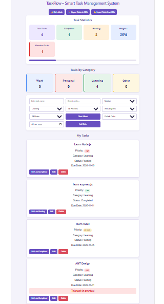

# TaskFlow – Smart Task Management System

TaskFlow is a task management web application built using React and TypeScript. It helps users organize daily tasks, track progress, manage priorities, and maintain productivity through a simple and interactive dashboard.
## Application Screenshot



## Features

- **Add Tasks:** Create tasks with a title, priority, category, and due date.
- **Edit Tasks:** Update existing task details.
- **Delete Tasks:** Remove tasks with confirmation.
- **Task Status:** Mark tasks as completed or pending.
- **Search Tasks:** Find tasks using their names.
- **Filter Tasks:** Filter by priority, category, and status.
- **Sort Tasks:** Sort tasks by priority or due date.
- **Task Statistics:** View total, completed, pending, and overdue tasks.
- **Category Summary:** View tasks grouped by Work, Personal, Learning, and Other.
- **Progress Tracking:** Monitor task completion percentage.
- **Dark Mode:** Switch between light and dark themes.
- **Local Storage:** Automatically save tasks and theme preferences.
- **CSV Export:** Download tasks as a CSV file.
- **CSV Import:** Import tasks from CSV files.
- **Duplicate Prevention:** Prevent duplicate task names when adding or importing tasks.

## Technologies Used

- React.js
- TypeScript
- HTML5
- CSS3
- Vite
- Browser Local Storage

## Installation and Setup

1. Clone the repository:

   ```bash
   git clone https://github.com/Harinirdy/TaskFlow.git
   ```

2. Navigate to the project folder:

   ```bash
   cd TaskFlow
   ```

3. Install dependencies:

   ```bash
   npm install
   ```

4. Start the development server:

   ```bash
   npm run dev
   ```

5. Open the local URL displayed in your terminal.

## Project Structure

```text
TaskFlow/
├── public/
├── src/
│   ├── components/
│   │   ├── TaskCard.tsx
│   │   └── TaskList.tsx
│   ├── types/
│   │   └── task.ts
│   ├── App.tsx
│   ├── App.css
│   └── main.tsx
├── index.html
├── package.json
└── README.md
```

## Future Improvements

- Add user authentication.
- Integrate a backend database.
- Add cloud-based task synchronization.

---

**Developed as a React and TypeScript learning project.**